# MasronDroid

MasronDroid is a Windows x64 desktop app for managing Android devices over USB and wireless ADB. It combines app management, debloating, interactive scrcpy mirroring, root modules, Fastboot, Recovery, and a command console. The interface is available in English and Indonesian.

**Debloat your Android phone from Windows.** Review system and user apps, compare package risk ratings, and disable or uninstall selected apps in batches. MasronDroid backs up APK files before uninstalling. Private app data is excluded.

Download the Windows x64 installer or portable ZIP from [GitHub Releases](https://github.com/f22r/MasronDroid/releases).

## Connect a device

1. Connect the phone with a USB data cable, enable **USB debugging** in Developer options, and accept the authorization prompt on the phone. If Windows does not recognize the device, check its [USB driver](https://developer.android.com/studio/run/device).
2. MasronDroid scans every two seconds. An MTP-only connection shows setup instructions. If several devices are present, select the desired target.
3. The **Devices** page opens the phone screen automatically. Click a text field in the mirror and type with your computer keyboard. Backspace, Enter, and navigation keys are handled by scrcpy; Tab can also move focus into the embedded screen. Desktop search boxes and consoles retain their own keyboard focus.
4. Use **Add device** for wireless discovery, pairing-code entry, or QR pairing. Android wireless debugging must be enabled; discovery depends on the local network allowing mDNS. If discovery is unavailable, enter the address and the pairing/connection ports shown on the phone.

The mirror includes Android navigation below the screen and camera, power, volume, and rotation controls above it. It appears only on Devices. A locked or protected Android screen may remain dark; use the lock-screen action or unlock directly on the phone when Android blocks capture. **Keep screen on** is in Device Connection, defaults on, and persists the device preference. Switching it off restores the original power and timeout settings captured by MasronDroid.

## Device management

- **Devices** shows RAM usage, storage and remaining space, battery level and readable battery-health estimates, CPU, ROM, Android version, app totals, and reported bootloader state. Availability depends on the phone and its permissions. The RAM card includes **Clean RAM**. Device Connection includes confirmed restart and shutdown actions. Marketing names use an offline device catalog; matching LineageOS Wiki illustrations have a generic fallback.
- **Application** lists app icons, names, package identifiers, APK sizes, readable cache sizes, system/user/disabled badges, and removal-risk ratings. Search while typing, sort using column headers or the sort selector, filter by state, and select rows individually or with the header checkbox. Packages removed for the current user appear only in their dedicated filter. Risk ratings are advisory and vary by source and device.
- Install multiple APKs, disable/re-enable packages, or uninstall selected apps in batches with per-app progress and custom confirmation/result dialogs. Before uninstalling, APKs and split APKs are saved under **Backups** beside the app; **Restore backup** lists the saved applications with their icons. Backups exclude private app data and accounts. Package changes target Android user 0 and are read back before success is reported.
- **Clear cache** uses the available Android cache-only command or the phone's Storage settings flow. It verifies the result and refreshes inventory afterward. Cache visibility and automation depend on Android/OEM restrictions; unavailable values or failed operations are not treated as successful cleanup. This action does not intentionally clear application data.
- **Running apps** has a RAM usage card, **Clean RAM**, **Refresh**, and **Release selected**. Protected or foreground processes are excluded from release where detected; Android can restart processes, so this is not a permanent memory limit.
- **Fastboot** provides bootloader/OEM-unlock status, supported partition discovery and confirmed image flashing, with a local staging copy before execution. Unlock controls require a fresh supported-device check and confirmation because unlocking can erase user data. Samsung Download Mode directs the operator to Odin. Unsupported commands remain disabled.
- **Recovery** groups mode transitions, staged ZIP sideload, recovery-log/storage diagnostics, and an integrated console. Commands require a compatible recovery/transport. The app copies a chosen ZIP into **SideloadPackages** before sending it; recovery determines whether it can be installed.
- **Rooting / ADB Sideload** provides a confirmed **Flash Magisk** flow: restart the selected phone into custom recovery, verify its capabilities, sideload the verified official package, read fresh installation logs, and reboot after confirmed installation. Detection includes TWRP, OrangeFox, PitchBlack, SkyHawk and recognized custom AOSP recoveries such as Lineage/Infinity. Recovery must expose ADB shell and readable installation logs; unsigned-package approval may still require interaction on the phone. Missing USB or unconfirmed installation stops automatic progression. The separate storage-transfer method remains available for manual flashing.
- When active Magisk is detected, **Flash Magisk** becomes **Uninstall Magisk & Clean Root**. After confirmation, TWRP/OrangeFox installs the verified official package under its required uninstall filename, restores boot and removes Magisk modules/startup files. The app verifies fresh uninstaller logs and cleanup before reboot, then checks Android and removes the official Magisk manager APK. This follows the [official uninstallation method](https://topjohnwu.github.io/Magisk/install.html#uninstallation); module data is removed. Unreadable data or another root manager blocks this operation. Installing only the manager APK does not block initial root installation.
- Module rows offer **Install** when an active Magisk or KernelSU runtime is detected. The app downloads the selected module, asks for confirmation, requests Shell root access if needed, selects the detected manager's installer and verifies the installed module ID/version. In KernelSU, Shell must be allowed in Superuser. Modules take effect after reboot; the app does not reboot automatically after a module install. An APK alone is insufficient. KernelSU modules follow the [KernelSU module guide](https://kernelsu.org/guide/module.html).
- **Root / Magisk Module** separates Magisk management from module browsing. Root detects the installed manager APK, active runtime, and available Magisk release, and offers an APK update when appropriate. The storage-transfer method can copy the verified flashable ZIP while Android is running, then enter recovery for manual installation when recovery cannot decrypt internal storage. Existing matching transferred files are reused.
- **Magisk Module** includes **Highlights**, a saved **All modules** catalog, live text filtering, source links, per-module download, and **Install from ZIP** for files on the computer. Highlights includes Zygisk Next, Vector, Shamiko, Tricky Store, HMA-OSS, Simple BShield, Play Integrity Fork, Always Strong, and Integrity Box. Catalog and release metadata are cached locally; Sync explicitly refreshes them. These are third-party projects, not compatibility guarantees or endorsements.
- **Installed** appears only when readable installed modules exist. It shows versions and pending-reboot state, checks supported update metadata, and offers verified updates. Android installation supports detected Magisk, KernelSU, and APatch runtimes with authorized Shell root access; supported recovery installation requires a writable root environment. Local ZIP installation validates module metadata and SHA-256 before transfer and verifies module ID/version afterward.
- **Console** accepts manual commands directly beneath wrapped output, follows the latest log entries, and supports cancellation and clear. Root, Fastboot, and Recovery share the same console presentation. Fastboot/Recovery input remains disabled until the required mode is available. Session logs and layout preferences are stored locally.

The [scrcpy keyboard guide](https://github.com/Genymobile/scrcpy/blob/v5.0.1/doc/keyboard.md) describes keyboard behavior and Android input limitations. MasronDroid uses scrcpy's compatible default SDK keyboard mode.

## Build from source

Use Windows x64, PowerShell, and a .NET SDK that supports .NET 10. Run these commands from the repository root.

```powershell
.\scripts\Prepare-Tools.ps1
dotnet run --project src/MasronDroid/MasronDroid.csproj
```

The [preparation script](scripts/Prepare-Tools.ps1) downloads pinned upstream archives and verifies their SHA-256 hashes. Run [Build-Release.ps1](scripts/Build-Release.ps1) to generate the installer, portable ZIP, and GitHub update feed. Run `dotnet run --project tests/MasronDroid.Checks -c Release` for the [automated checks](tests/MasronDroid.Checks/Program.cs).

## Credits

Module ZIP metadata, including XZ-compressed entries, is read using [SharpCompress](https://github.com/adamhathcock/sharpcompress), distributed under the [MIT license](https://github.com/adamhathcock/sharpcompress/blob/0.50.4/LICENSE.txt).

**Screen mirroring and input are powered by scrcpy**, developed by **Genymobile and the scrcpy contributors**. MasronDroid bundles the Windows client and matching Android server from scrcpy 5.0.1. Its Apache License 2.0 is included in the application payload at `tools/scrcpy/LICENSE.txt`. [scrcpy project](https://github.com/Genymobile/scrcpy) · [upstream release](https://github.com/Genymobile/scrcpy/releases/tag/v5.0.1) · [license](https://github.com/Genymobile/scrcpy/blob/v5.0.1/LICENSE)

ADB and Fastboot come from Google's Android SDK Platform-Tools. Device marketing names come from Google Play's supported device list. Model illustrations come from contributors to LineageOS Wiki. Velopack provides Windows packaging and updates. [Platform-Tools](https://developer.android.com/tools/releases/platform-tools) · [device catalog](https://storage.googleapis.com/play_public/supported_devices.html) · [device illustrations](https://github.com/LineageOS/lineage_wiki/tree/bf49224b3a8838ad67f42e014435d5feeae5a668/images/devices) · [Velopack](https://github.com/velopack/velopack)


## Screenshots

Captured from the current Windows source build on November 3, 2026, with a connected Redmi Note 9. Fastboot and Recovery pages are shown while the phone remains in Android; mode-specific controls are therefore disabled. Device identifiers and private console output are hidden in public images. Published release installers may lag behind the source build shown here.

### Applications and debloat

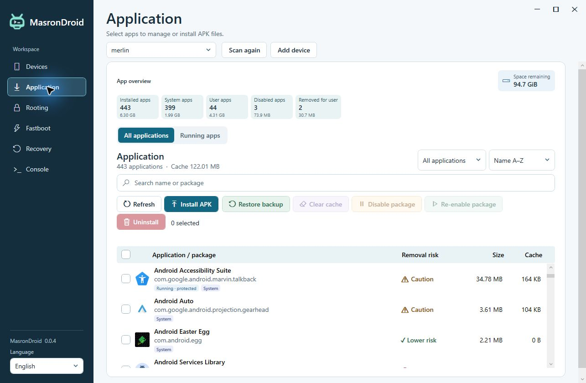

### Running apps and RAM

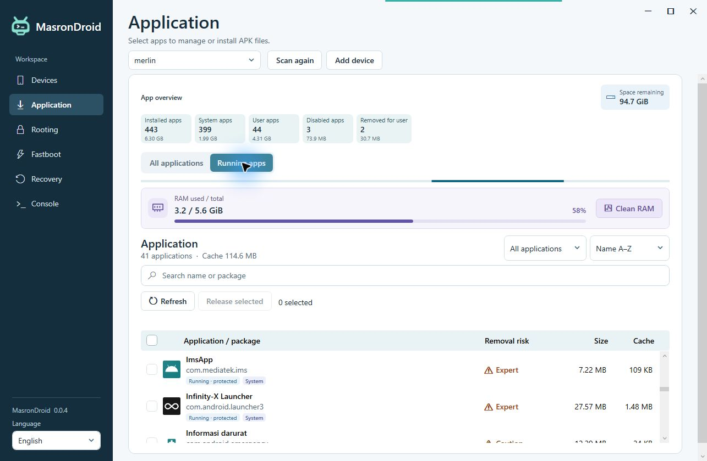

### Device

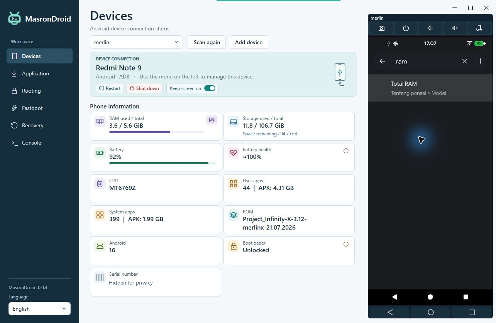

### Root management

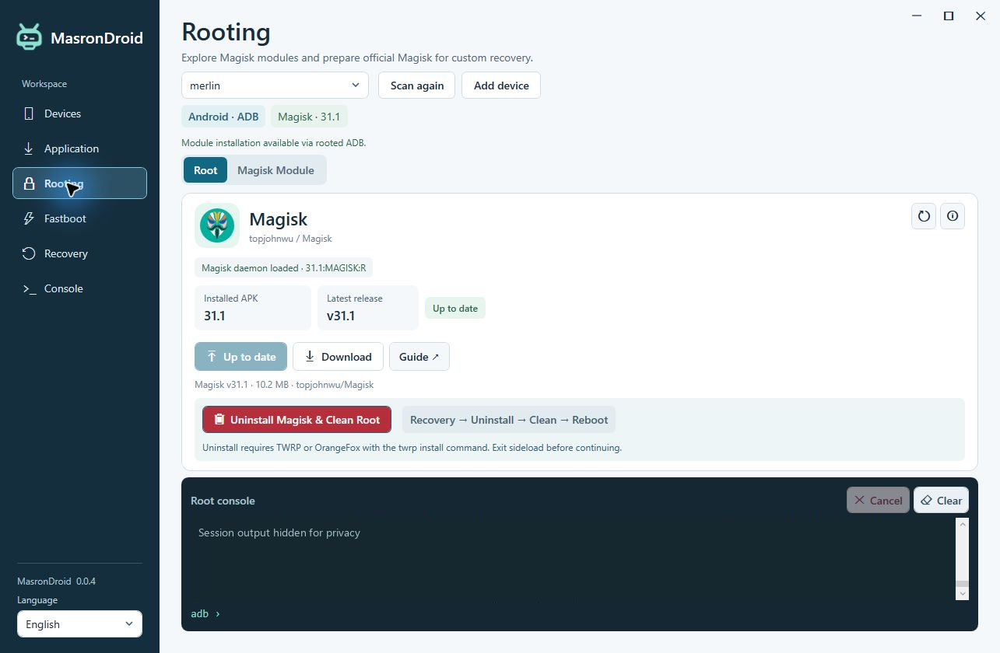

### Magisk Module highlights

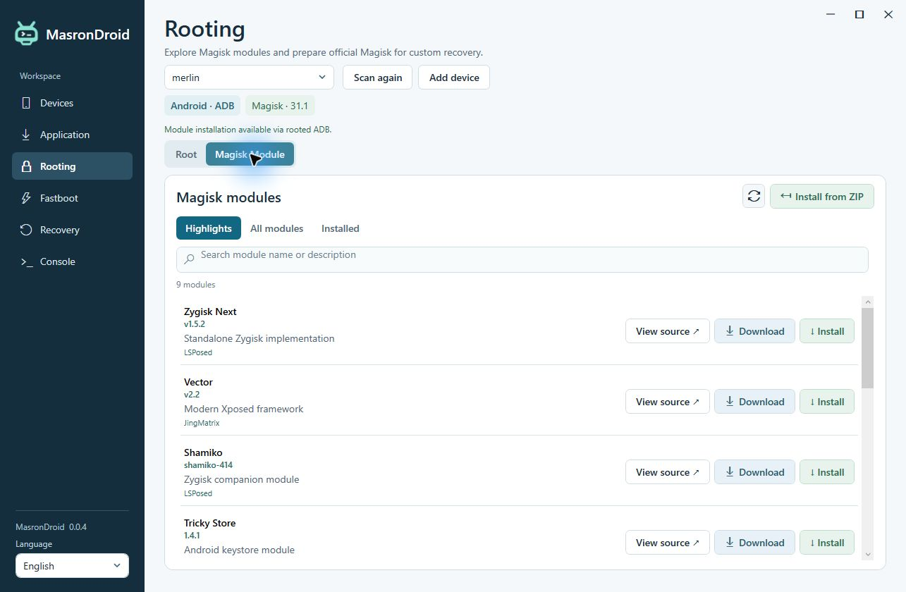

### Saved module catalog

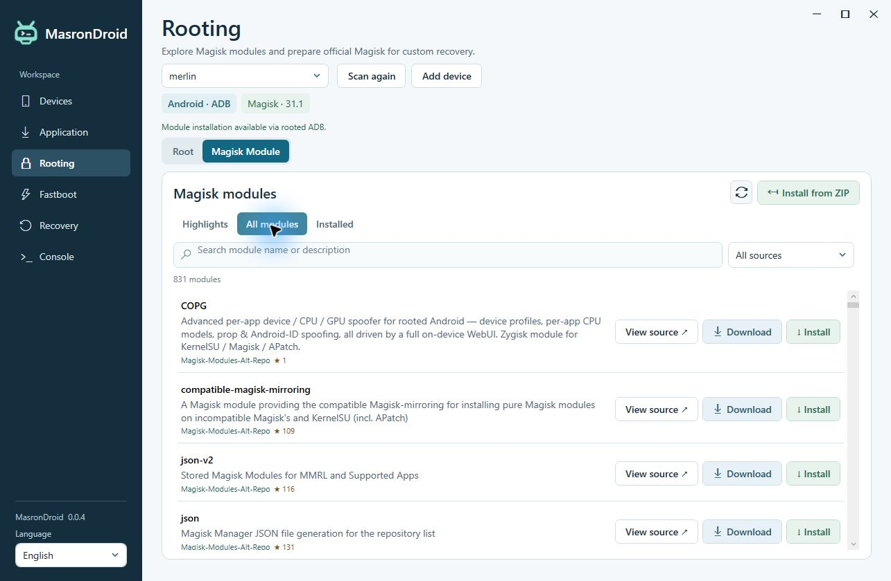

### Installed modules

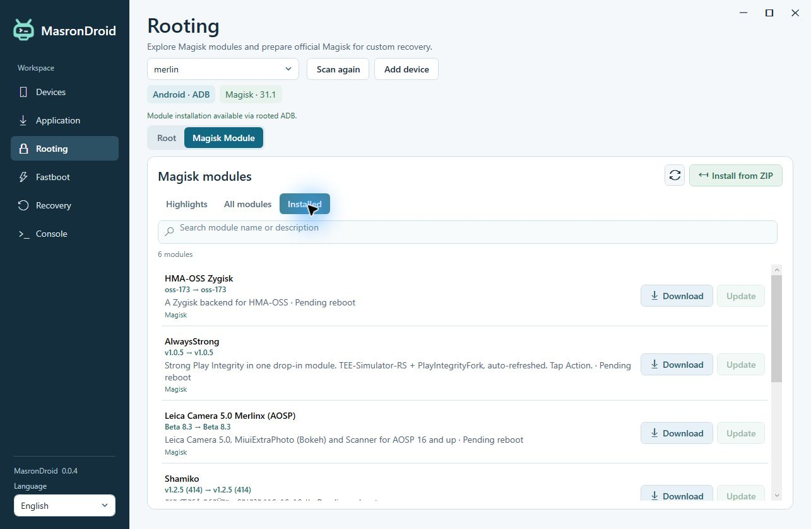

### Fastboot

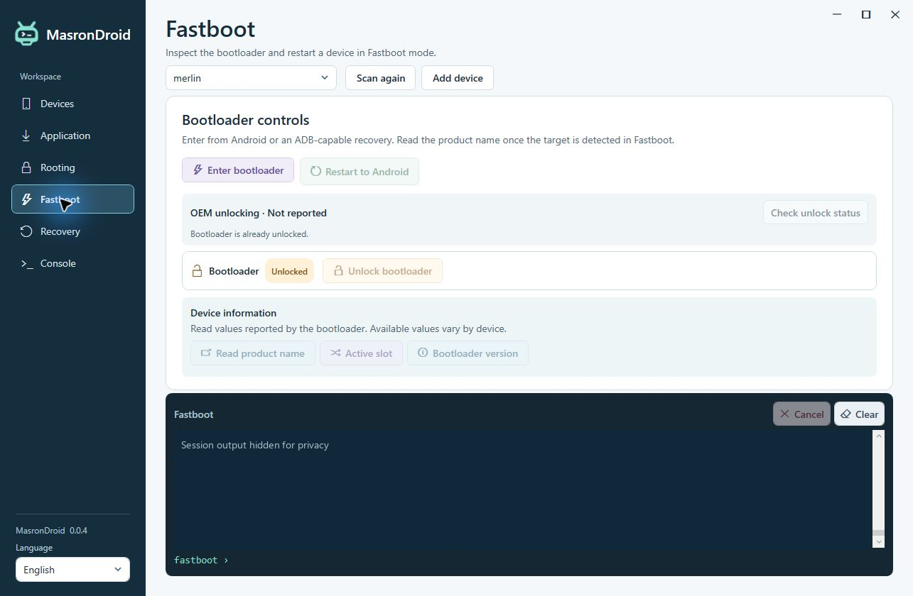

### Recovery

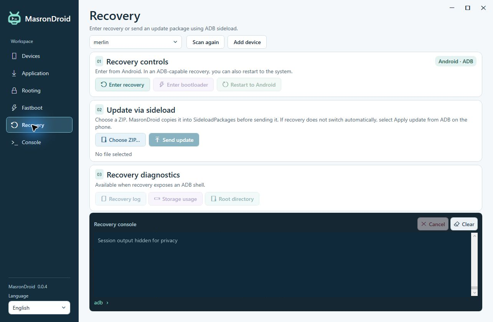

### Console

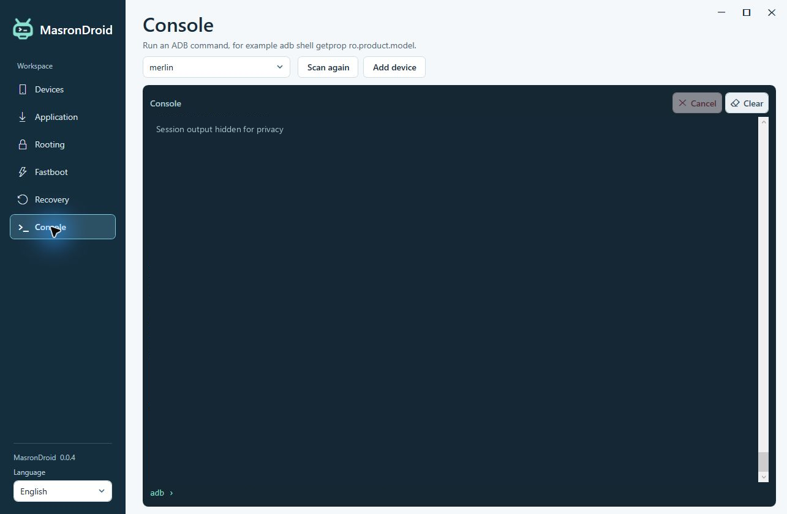

### Wireless pairing

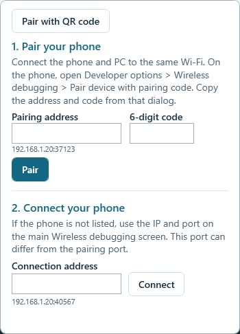
